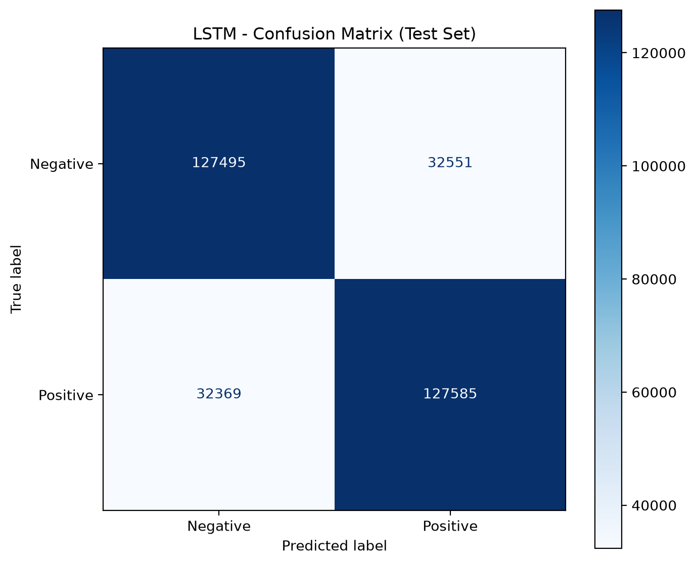

# Phân tích cảm xúc văn bản bằng Word2Vec và LSTM – Nhóm 9

Đề tài môn Học sâu. Phân loại cảm xúc tweet tiếng Anh thành **Negative / Positive** trên bộ dữ liệu Sentiment140, dùng vector Word2Vec làm Embedding và mạng LSTM cài đặt bằng PyTorch (GPU).

- **GVHD:** TS. Trần Thị Minh Hạnh
- **Thành viên:** Nguyễn Đức Trúc, Nguyễn Tấn Vỹ, Nguyễn Trường Thọ
- **Notebook tham khảo:** https://www.kaggle.com/code/prashant268/sentiment-analysis-lstm

## 1. Báo cáo

| Tài liệu | Đường dẫn |
|---|---|
| Báo cáo (PDF) | [`Bao_cao_Sentiment_LSTM_Nhom12.pdf`](Bao_cao_Sentiment_LSTM_Nhom12.pdf) |
| Báo cáo (Word) | [`Bao_cao_Sentiment_LSTM_Nhom12.docx`](Bao_cao_Sentiment_LSTM_Nhom12.docx) |

## 2. Dữ liệu

- **Sentiment140:** https://www.kaggle.com/datasets/kazanova/sentiment140 (1.600.000 tweet, 800.000 mỗi lớp)

Dữ liệu không đưa lên GitHub vì dung lượng lớn. Tải file `training.1600000.processed.noemoticon.csv` rồi đặt vào thư mục gốc của project.

## 3. Kết quả trên tập test (320.000 tweet)

| Lớp | Precision | Recall | F1-score |
|---|---:|---:|---:|
| Negative | 79,75% | 79,66% | 79,71% |
| Positive | 79,67% | 79,76% | 79,72% |
| **Accuracy** | | | **79,71%** |

- Checkpoint tốt nhất: epoch 12/15 (validation accuracy 79,77%)
- Số tham số: 9.295.301 (trong đó 160.901 được huấn luyện; Embedding Word2Vec đóng băng)



## 4. Mô hình

```
Token IDs → Embedding Word2Vec 300d (đóng băng) → Dropout 0,5
          → LSTM 100 (pack_padded_sequence) → Linear 100→1 → Sigmoid
```

- Word2Vec CBOW, 300 chiều, window 7, min_count 10, 30 epoch → 30.446 từ (+ PAD, UNK)
- Adam lr 0,001, batch 128, 15 epoch, BCEWithLogitsLoss, gradient clipping 1,0

## 5. Cách chạy

Yêu cầu Python 3.12 và GPU NVIDIA có CUDA.

```bash
python -m venv .venv
.venv\Scripts\activate
pip install -r requirements.txt

python kiem_tra_gpu.py          # kiểm tra GPU
python doc_du_lieu.py           # đọc và thống kê dữ liệu
python xu_ly_du_lieu.py         # tiền xử lý  -> sentiment140_clean.csv
python chia_du_lieu.py          # chia 80/20   -> data_split.npz
python huan_luyen_word2vec.py   # Word2Vec    -> word2vec.model
python xay_dung_lstm.py         # từ điển      -> vocab_lstm.json
python train_lstm.py            # huấn luyện   -> lstm_best.pth, history_lstm.csv
python danh_gia_lstm.py         # đánh giá test
python ve_bieu_do_lstm.py       # vẽ biểu đồ
python du_doan_cam_xuc.py       # dự đoán câu mới
```

## 6. Các file trong repo

| Nhóm | File |
|---|---|
| Báo cáo | Bao_cao_Sentiment_LSTM_Nhom12.pdf, Bao_cao_Sentiment_LSTM_Nhom12.docx |
| Mã nguồn | 10 file .py theo từng bước (mục 5) |
| Kết quả | ket_qua_test.txt, history_lstm.csv, bieu_do_accuracy_lstm.png, bieu_do_loss_lstm.png, confusion_matrix_lstm.png |
| Notebook | sentiment-analysis-lstm.ipynb (tham khảo), lstm_pytorch_gpu.ipynb |
